# Materials Science Simulator

An educational Python / Jupyter toolkit with **3D interactive visualizations** for steel metallurgy and materials engineering: Fe-C phase diagram and lever rule, heat treatment (quench + temper), TTT/CCT curves, stress-strain behaviour, von Mises / Tresca / Mohr-Coulomb yield surfaces, Ashby materials selection, and fatigue life (Basquin + Goodman).

> **Disclaimer:** curves, boundaries and material values are simplified and conceptual, made for learning and visualization. Do not use them for real engineering design or safety-critical decisions without validated data.

---

## 3D Gallery

### Phase Diagram & Lever Rule

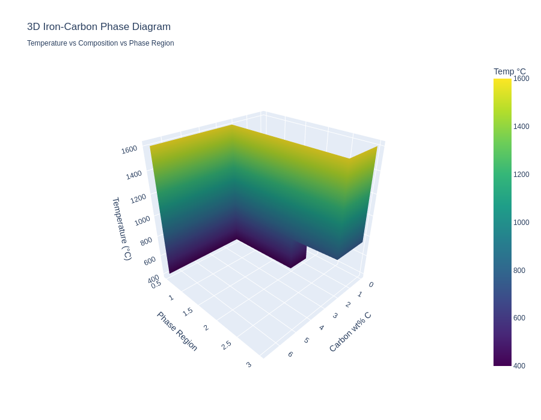

| 0.4% C at 700°C | 0.85% C at 600°C |
|---|---|
| 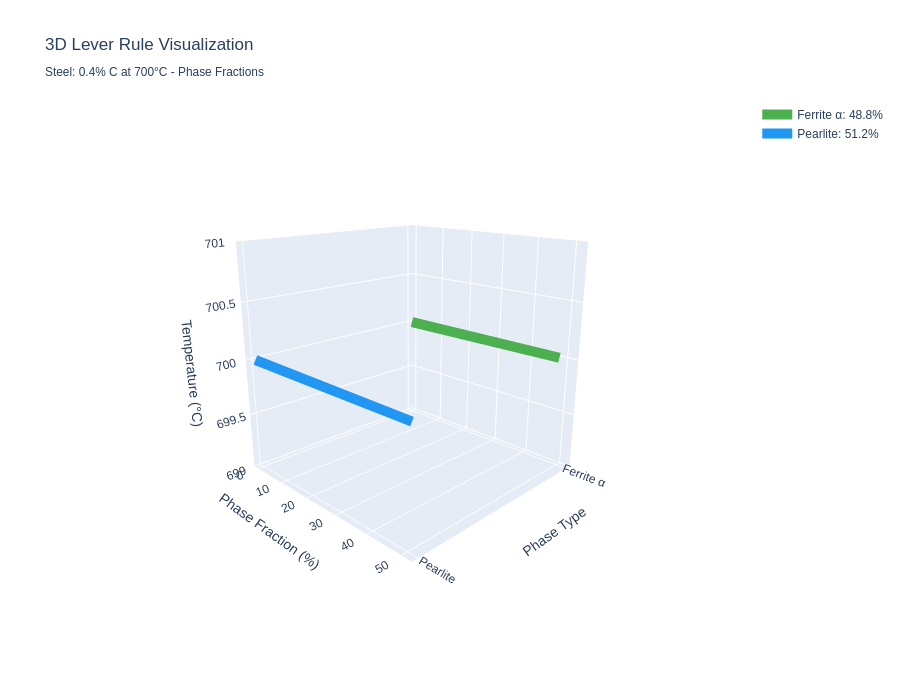 | 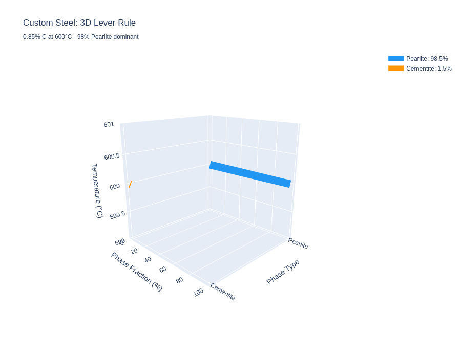 |

| 1.2% C at 650°C (hypereutectoid) | 1.5% C at 720°C |
|---|---|
| 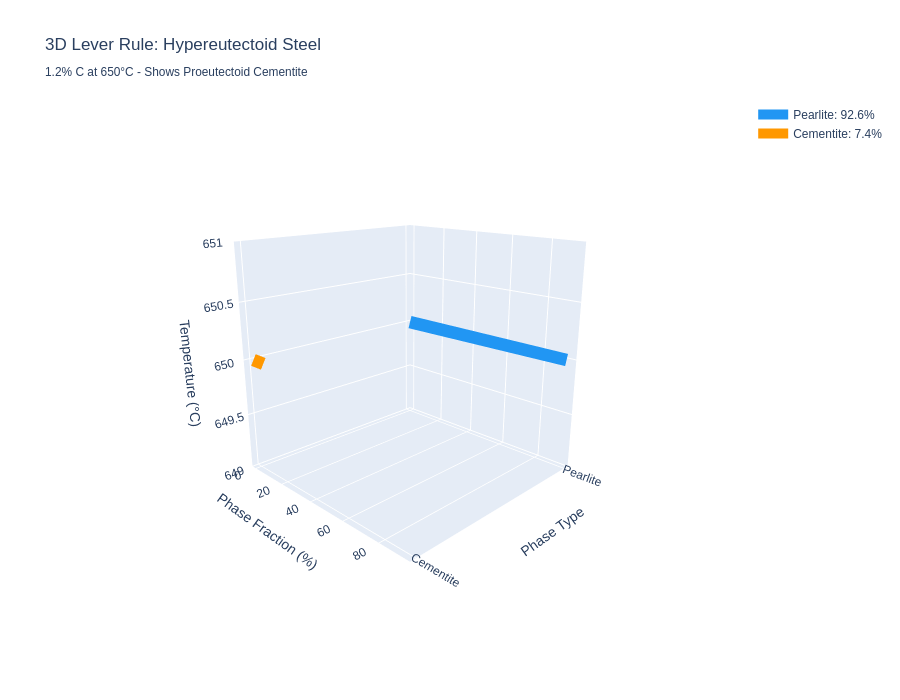 | 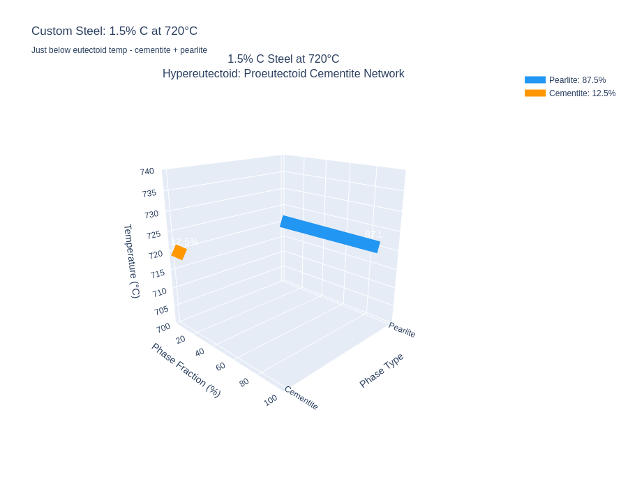 |

### Heat Treatment: TTT & CCT

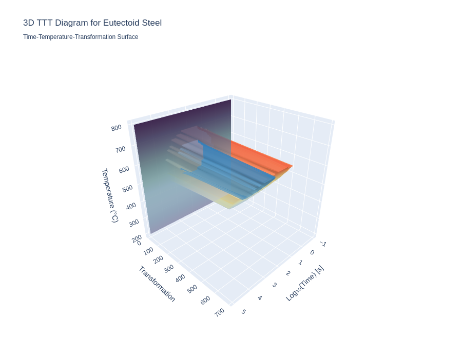

| TTT with cooling paths | 3D CCT diagram |
|---|---|
| 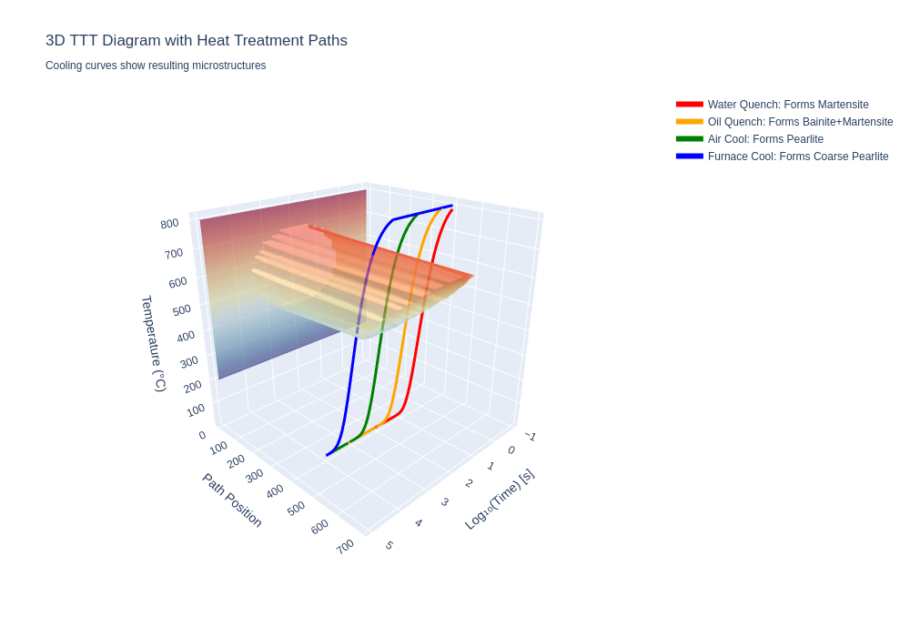 | 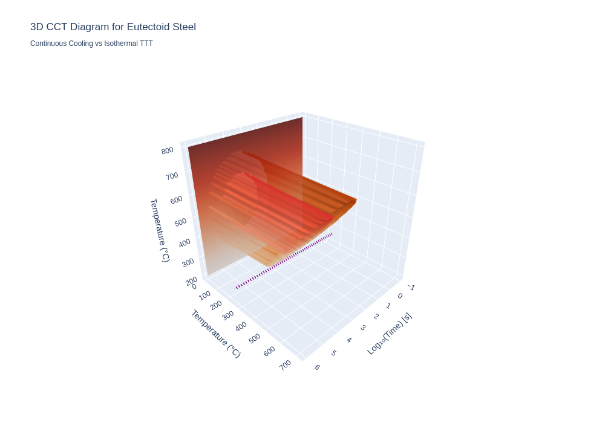 |

### Mechanical Behaviour: Yield Surfaces

| von Mises yield surface | von Mises vs Tresca vs Mohr-Coulomb |
|---|---|
| 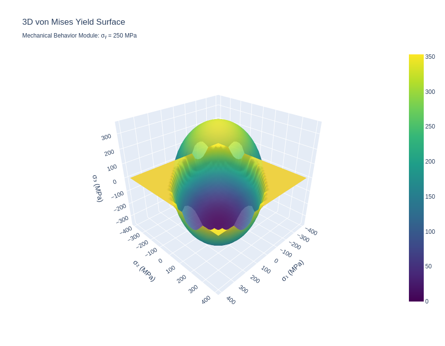 | 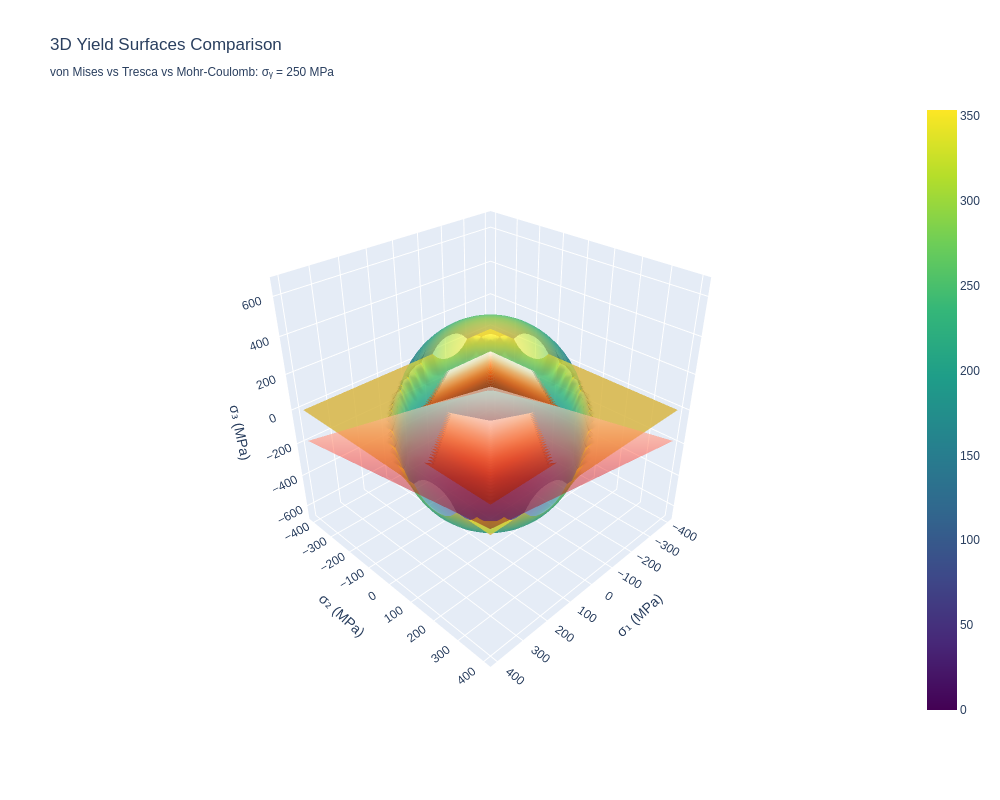 |

### Materials Selection: Ashby Charts

| Strength vs Density vs Cost | Aerospace materials (+ toughness) |
|---|---|
| 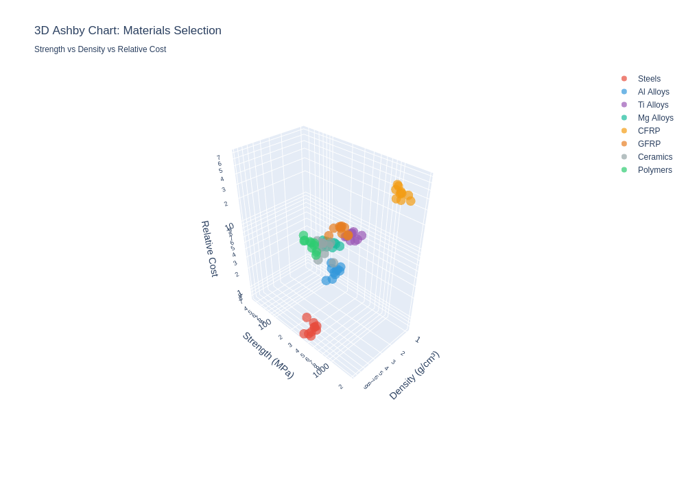 | 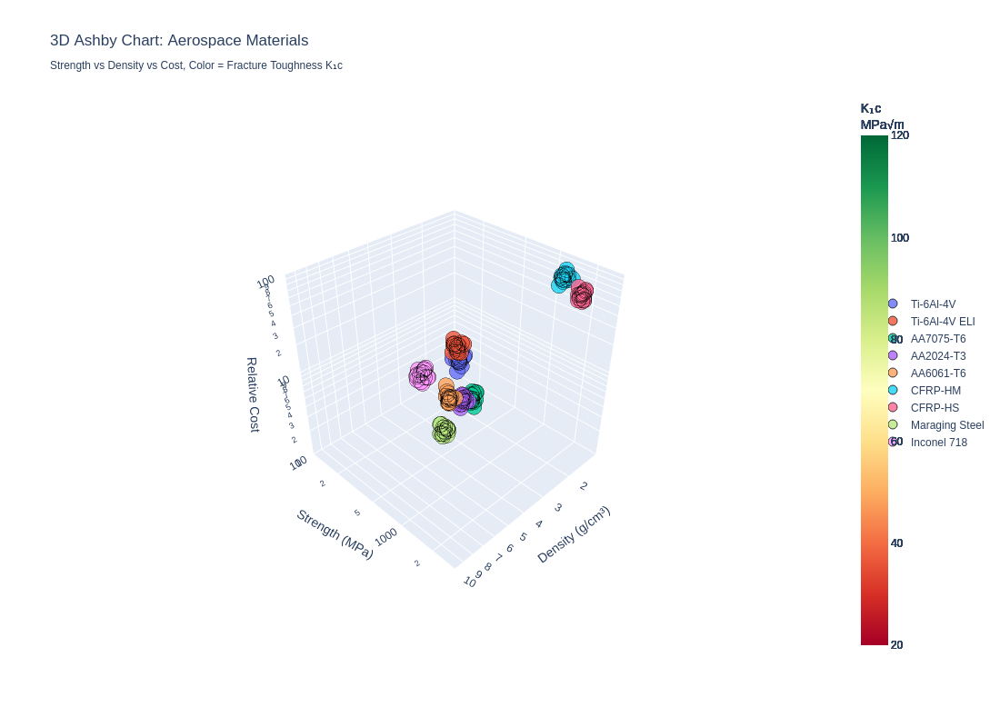 |

---

## Interactive 3D Files (HTML)

Each `.html` file is a fully interactive Plotly figure (rotate, zoom, hover). Download and open in a browser, or enable **GitHub Pages** (Settings → Pages → deploy from `main` / root) and open them at `https://hskhalsa1990.github.io/materials-science-simulator/<file>.html`.

| File | Content |
|---|---|
| `lever_rule_1_2C_3d.html` | Lever rule, 1.2% C hypereutectoid steel |
| `custom_steel_3d.html` | Custom steel, 0.85% C |
| `steel_1_5C_720C.html` | 1.5% C at 720°C |
| `ttt_with_cooling_3d.html` | TTT with cooling curves |
| `cct_3d.html` | CCT diagram with Ms line |
| `phase_animation_3d.html` | Animated transformation 900°C → 400°C |
| `yield_surface_3d.html` | von Mises yield surface |
| `yield_surfaces_comparison.html` | von Mises vs Tresca vs Mohr-Coulomb |
| `ashby_3d.html` | Ashby chart, all materials |
| `ashby_aerospace_3d.html` | Ashby chart, aerospace filter |

## Notebook Modules

`Materials_Science_Simulator_MASTER.ipynb` contains:

1. Fe-C phase diagram + lever rule (hypo- and hypereutectoid)
2. Heat treatment engine (quench media + tempering) with hardness maps
3. TTT / CCT conceptual curves + 3D process surface
4. Multi-temperature stress-strain curves + 3D surface
5. Ashby charts (28 materials), ranking and Pareto view
6. Fatigue life (Basquin + Goodman), 5 alloys + 3D surface
7. Master dashboard and scenario comparison

## Quick Start

```bash
git clone https://github.com/hskhalsa1990/materials-science-simulator.git
cd materials-science-simulator
pip install -r requirements.txt
jupyter notebook Materials_Science_Simulator_MASTER.ipynb
```

## Repository Layout

Flat layout: everything is in the repository root (README, requirements, notebook, 12 PNG images, 10 interactive HTML files).

## Author

Harpreet Singh — [@hskhalsa1990](https://github.com/hskhalsa1990)
